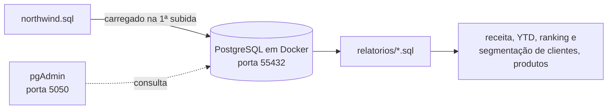
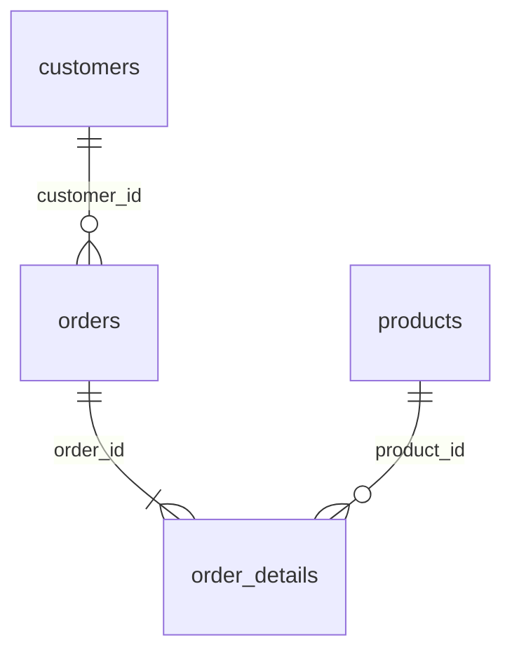

# Análise de vendas Northwind com SQL

**Página no portfólio:** https://dev-pprado.github.io/projetos/northwind-sales-analytics/

Relatórios em SQL sobre o banco Northwind (uma distribuidora fictícia de alimentos) para responder perguntas de negócio sobre receita, clientes e produtos. O banco roda em PostgreSQL com pgAdmin via Docker Compose e é carregado automaticamente na primeira subida.

## Como funciona



Todas as consultas usam a mesma fórmula de receita, que aplica o desconto de cada item do pedido:

```text
receita = unit_price × quantity × (1 - discount)
```

### Os relatórios

| Arquivo | Pergunta | Técnicas |
|---|---|---|
| [`01_total_revenues_1997.sql`](relatorios/01_total_revenues_1997.sql) | Qual foi a receita total em 1997? | `SUM`, subconsulta, `EXTRACT(YEAR)` |
| [`02_receitas_acumuladas_YTD.sql`](relatorios/02_receitas_acumuladas_YTD.sql) | Como a receita evoluiu mês a mês e quanto acumulou no ano? | Duas CTEs, `SUM() OVER` para a receita acumulada (YTD), `LAG()` para a diferença e a variação % em relação ao mês anterior |
| [`03_total_revenues_per_customer.sql`](relatorios/03_total_revenues_per_customer.sql) | Quanto cada cliente gerou de receita? | JOIN entre `customers`, `orders` e `order_details`, `GROUP BY` |
| [`04_total_revenues_per_customer_group.sql`](relatorios/04_total_revenues_per_customer_group.sql) | Em que faixa de valor cada cliente está? | `NTILE(5)` sobre a receita, do grupo 1 (maior valor) ao 5 (menor) |
| [`05_total_revenues_per_customer_group_low.sql`](relatorios/05_total_revenues_per_customer_group_low.sql) | Quais clientes podem ser alvo de uma campanha de marketing? | CTE com a segmentação do relatório 04, filtrando os grupos 3, 4 e 5 |
| [`06_top_10_produtos.sql`](relatorios/06_top_10_produtos.sql) | Quais produtos geram mais receita? | JOIN entre `products` e `order_details`, ordenação por receita |
| [`07_uk_clientes_pay_more_1000.sql`](relatorios/07_uk_clientes_pay_more_1000.sql) | Quais clientes do Reino Unido pagaram mais de 1.000? | `HAVING`, criação de uma `VIEW` reutilizável |

### Modelo de dados

As consultas usam principalmente quatro tabelas:



O diagrama completo do banco está em [`pics/northwind-er-diagram.png`](pics/northwind-er-diagram.png).

### Decisões

- **Uma pergunta por arquivo:** cada relatório é independente e pode ser executado sozinho no pgAdmin ou no `psql`.
- **CTEs em vez de subconsultas aninhadas:** no relatório 02, uma CTE calcula a receita mensal e outra acumula o ano, então cada passo pode ser lido e testado separadamente.
- **Window functions para comparar períodos:** `LAG` e `SUM() OVER (PARTITION BY ano ORDER BY mês)` fazem a comparação com o mês anterior e o acumulado sem precisar de auto-JOIN.
- **Ambiente reproduzível:** o dump é montado em `docker-entrypoint-initdb.d`, então o banco sobe já populado em qualquer máquina.

## Stack

| Parte | Tecnologias |
|---|---|
| Análise | SQL (PostgreSQL) |
| Ambiente | Docker Compose, PostgreSQL, pgAdmin |

## Como rodar localmente

Pré-requisito: Docker com Docker Compose.

```sh
docker compose up -d        # sobe o PostgreSQL (já com o Northwind) e o pgAdmin
docker compose down         # para os containers
docker compose down -v      # para e apaga os volumes (o banco é recriado na próxima subida)
```

| Serviço | Endereço | Acesso |
|---|---|---|
| PostgreSQL | `localhost:55432`, banco `northwind` | usuário `postgres`, senha `postgres` |
| pgAdmin | http://localhost:5050 | sem login. Cadastre o servidor com host `db`, porta `5432` |

Para rodar um relatório pelo terminal:

```sh
docker exec -i db psql -U postgres -d northwind < relatorios/03_total_revenues_per_customer.sql
```

## Estrutura

```text
.
├── relatorios/           # consultas SQL, uma por pergunta de negócio
├── pics/                 # northwind-er-diagram.png
├── northwind.sql         # dump do banco (tabelas e dados)
└── docker-compose.yml    # PostgreSQL e pgAdmin
```

## Limitações conhecidas

- **Relatório 06 incompleto:** o arquivo começa sem o `SELECT` e não tem o `LIMIT 10`, então não executa como está.
- **Relatório 07 cria uma view:** rodar duas vezes dá erro porque a view já existe (`CREATE OR REPLACE VIEW` resolveria).
- **Resultados não documentados:** os relatórios ainda não têm os resultados salvos junto com as consultas.

## Próximos passos

- [ ] Corrigir o relatório 06
- [ ] Crescimento ano contra ano (YoY)
- [ ] Ranking de clientes com `RANK()`
- [ ] Análise RFM e de retenção de clientes
- [ ] Conectar ao banco com Python e gerar gráficos dos resultados
